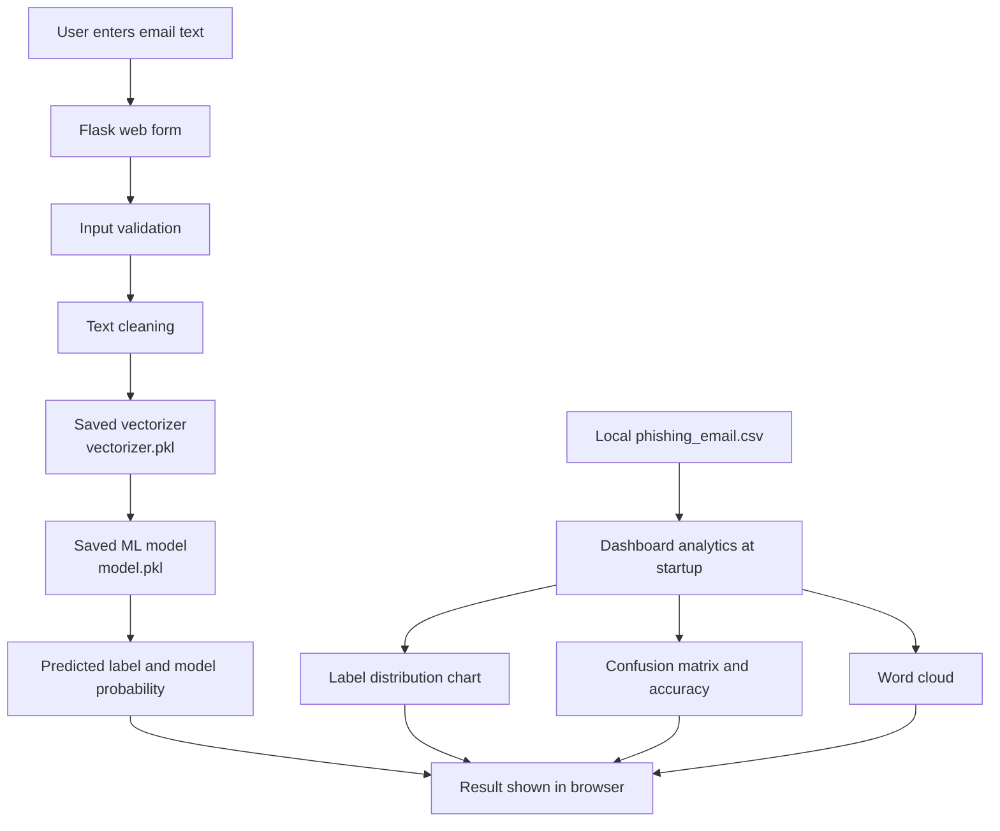

# Project Architecture and Workflow

## Architecture diagram

## Prediction workflow

1. **Input:** The user pastes an email body into the form in `templates/index.html`.
2. **Validation:** `app.py` checks whether the submitted text is empty.
3. **Preprocessing:** `clean_text()` removes HTML-like tags and URLs, retains letters, converts text to lowercase, and removes English stopwords.
4. **Vectorization:** `vectorizer.pkl` transforms the cleaned text into model features.
5. **Classification:** `model.pkl` predicts the label (`1` = phishing, `0` = legitimate).
6. **Result:** The web page displays the class and the highest probability returned by `predict_proba`.
7. **Dashboard:** At startup, the app loads `phishing_email.csv` and builds visualizations. This means the CSV is currently required even when only testing a single email.

## Main files

- `app.py` — Flask route, preprocessing, inference, and dashboard creation
- `server.py` — Waitress serving entry point
- `templates/index.html` — HTML form and Plotly chart rendering
- `model.pkl` — serialized trained classifier
- `vectorizer.pkl` — serialized text feature transformer
- `phishing_email.csv` — local dataset, excluded from Git due to size

## Trust and evaluation notes

- Only load pickle files from a trusted source.
- Verify that the saved model and vectorizer were created by compatible versions of the same training pipeline.
- The dashboard accuracy is computed against the CSV labels loaded by the app. Unless these rows are a held-out test set, it is not an unbiased estimate of generalization performance.
